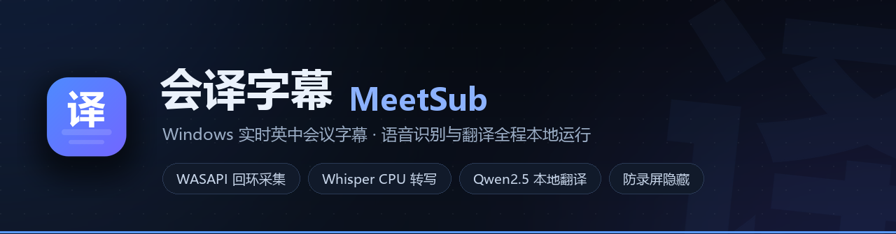
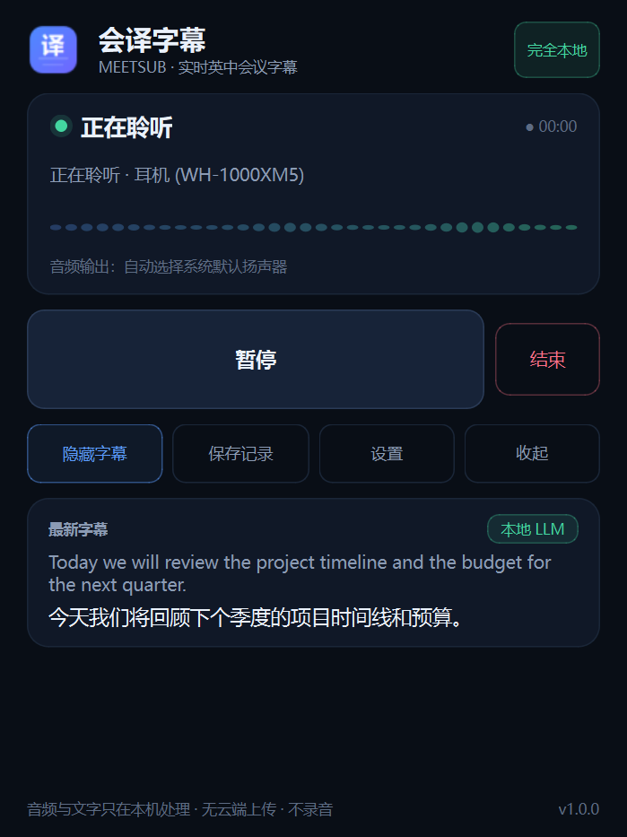
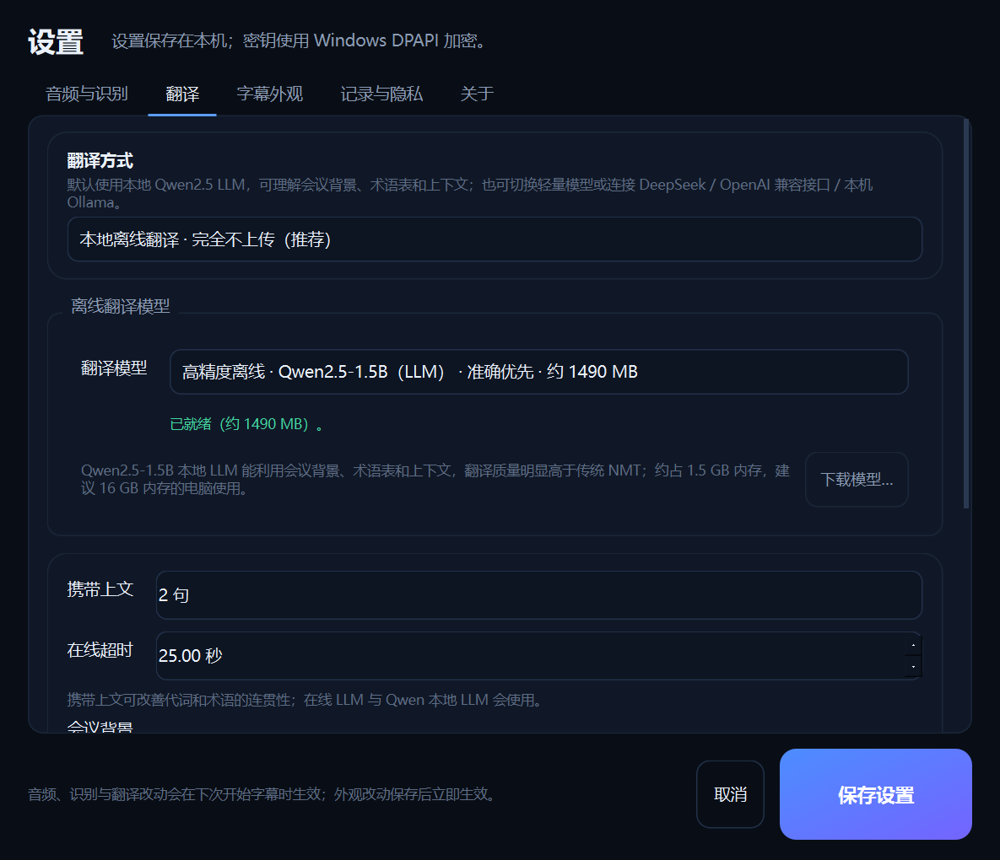
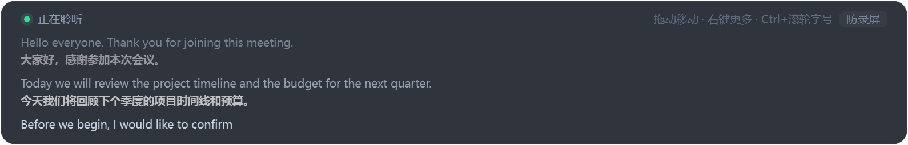
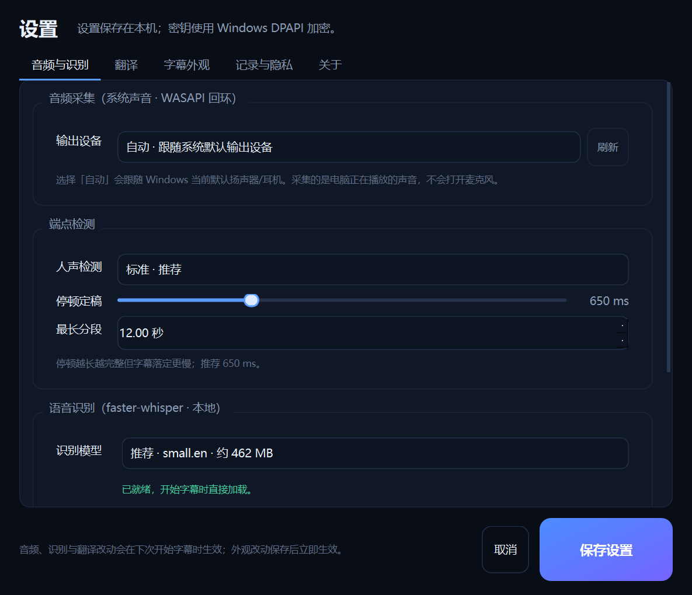
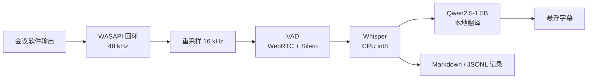

# 会译字幕 · MeetSub

<p align="center">
  
</p>

<p align="center">
  <a href="LICENSE"></a>
  
  
  
  
  <a href="https://github.com/TNTD26/MeetSub/actions/workflows/ci.yml"></a>
</p>

<p align="center">
  面向 Windows 线上会议的<b>实时英中字幕</b>：<br>
  抓取电脑正在播放的声音 → 本地 Whisper 转写 → 本地 Qwen 翻译 → 置顶悬浮字幕。<br>
  默认配置全程离线，<b>音频和文字都不离开你的电脑</b>。
</p>

> MeetSub is a Windows-only, fully local English → Simplified Chinese live subtitle overlay
> for online meetings. It captures system audio (WASAPI loopback), transcribes with
> faster-whisper and translates with a local Qwen2.5-1.5B, then shows a click-through,
> always-on-top overlay that can hide itself from screen sharing.

---

## 目录

- [为什么做这个](#为什么做这个)
- [界面](#界面)
- [三步开始](#三步开始)
- [功能](#功能)
- [工作原理](#工作原理)
- [翻译质量](#翻译质量)
- [资源占用](#资源占用)
- [隐私与安全](#隐私与安全)
- [安装](#安装)
- [常用操作](#常用操作)
- [设置要点](#设置要点)
- [模型与下载](#模型与下载)
- [字幕记录](#字幕记录)
- [故障排查](#故障排查)
- [已知限制](#已知限制)
- [开发与构建](#开发与构建)
- [许可与致谢](#许可与致谢)

## 为什么做这个

英文会议里的信息密度很高，但**听不懂就是听不懂**：语速快、口音重、术语多，回放还要等录制文件。
市面上的实时字幕要么走云端（把会议内容传出去），要么只是把英文识别出来，对中文读者帮助有限。

MeetSub 的三个目标：

1. **直接读中文**——英文原声与简体中文双语上屏，句末即出译文，不用等会议结束；
2. **可以放心开**——默认识别与翻译都在本机 CPU 上跑，离线可用，不录音、无账号、无遥测；
3. **不干扰会议**——字幕置顶但不抢焦点；不需要时可一键让它在屏幕共享里消失。

## 界面

<table align="center">
  <tr>
    <td align="center" width="34%">
      <br>
      <sub><b>主窗口</b>：开始 / 暂停 / 结束，实时电平与最新一句字幕</sub>
    </td>
    <td align="center" width="66%">
      <br>
      <sub><b>翻译设置</b>：默认 Qwen2.5 本地 LLM，可填写会议背景与术语表</sub>
    </td>
  </tr>
</table>

<p align="center">
  <br>
  <sub><b>悬浮字幕</b>：始终置顶、可拖动、鼠标穿透，最多保留最近 3 段；标记「防录屏」后对屏幕共享不可见</sub>
</p>

<table align="center">
  <tr>
    <td align="center">
      <br>
      <sub><b>音频与识别</b>：跟随默认输出，端点检测与识别模型</sub>
    </td>
  </tr>
</table>

## 三步开始

1. 打开应用，确认左上角状态是 **准备就绪**。
2. 点 **开始实时字幕**。应用自动捕获 Windows 当前默认输出设备播放的声音，**不需要选择麦克风**。
3. 加入 Zoom / Teams / Google Meet / Webex 等会议，悬浮字幕出现在屏幕底部。

首次开始需要加载并预热 Whisper 与 Qwen，通常 9–13 秒；之后开始会快很多。
应用只允许运行一个实例，重复启动会唤醒已运行的窗口。

## 功能

| 类别 | 能力 |
| --- | --- |
| **音频** | WASAPI 回环采集系统输出，跟随默认扬声器/耳机，也可手动指定设备；暂停时真正关闭音频流 |
| **识别** | faster-whisper + CTranslate2，CPU int8；WebRTC VAD 切句 + Silero ONNX 二次校验；支持识别热词 |
| **翻译** | 默认本地 Qwen2.5-1.5B 指令模型（带会议背景 / 术语表 / 上文）；可切 M2M100、OPUS-MT、在线 DeepSeek/OpenAI 兼容接口、本机 Ollama，或仅转写 |
| **字幕** | 英中双语，最多保留最近 3 段（可调）；字体、字号、颜色、背景浓度、宽度、位置全可调 |
| **窗口** | 原生 topmost 不抢焦点；可拖动；鼠标穿透；不在 Alt+Tab 出现；托盘常驻 |
| **隐私** | 默认全离线；可选在线翻译只发文字；API Key 用 DPAPI 加密；字幕窗口可对屏幕共享隐藏 |
| **记录** | 自动保存 Markdown + JSONL，原子写入；可手动导出；可一键打开记录目录 |
| **模型** | 应用内下载、断点续传、镜像切源（hf-mirror / Hugging Face） |

## 工作原理



一句话：**采集在 `audio.py`，断句在 `vad.py`，转写在 `transcriber.py`，翻译在
`translator.py`，编排在 `pipeline.py`，界面在 `ui/`。** 采集、识别、翻译各跑在自己的线程，
互不阻塞。

更细的模块分工、分段策略和设计取舍见 [docs/DESIGN.md](docs/DESIGN.md)。

## 翻译质量

为什么值得为本地 LLM 多付 1.5 GB 内存和一秒延迟——同一句、同机、同时刻的对比：

| 英文原句 | M2M100-418M | Qwen2.5-1.5B（默认） |
| --- | --- | --- |
| We need to align on the launch date before Friday. | 我们需要在星期五之前调整发射日期。 | 我们需要在周五之前确定发布日期。 |
| Let me share my screen and walk you through the architecture. | 让我分享我的屏幕，让你走过建筑。 | 让我展示屏幕，并带您讲解架构。 |
| The SLA requires 99.9% uptime, so the rollback plan is critical. | — | SLA 要求 99.9% 的可用性，因此回滚计划至关重要。 |

传统 NMT 逐句翻译、没有上下文，`launch`、`architecture` 这类词的误译会直接影响理解；
Qwen 可以把「会议背景 + 术语表 + 最近两句」一起放进提示词，代价是每句约 1–2 秒生成时间。

## 资源占用

| 项目 | 默认值 |
| --- | --- |
| 语音识别 | `small.en`，int8，8 CPU 线程 |
| 离线翻译 | Qwen2.5-1.5B int8（Apache-2.0） |
| 翻译方式 | 完全离线 |
| 字幕位置 | 屏幕底部居中，宽度 1060 px |
| 字号 | 英文 16 px / 中文 23 px |
| 防录屏 | 开（Windows 10 2004+） |
| 自动保存记录 | 开 |
| 模型下载体积 | 约 2.0 GB（另附 2 个轻量翻译模型，合计约 2.9 GB） |
| 常驻内存 | 约 2–2.8 GB（界面本身 80–150 MB） |
| 首次启动 | 9–13 秒（加载并预热模型） |

**低配 / 低延迟方案**：换 `base.en` 或 `tiny.en`，翻译切 M2M100 / OPUS-MT，或直接用在线接口。
8 GB 内存的机器建议这样配置。

## 隐私与安全

| 设计 | 做法 |
| --- | --- |
| 音频不出本机 | WASAPI 数据只进进程内存，没有网络发送路径，也不写音频文件 |
| 默认可全离线 | 识别与翻译模型都在本地，断网可用 |
| 在线只发文字 | 主动选择在线翻译时，发送的是转写后的英文文本，绝不含音频 |
| 密钥加密 | API Key 经 Windows DPAPI 加密到 `%APPDATA%\MeetSub\secrets.bin`，配置里没有明文 |
| 防录屏 | 字幕窗口 `SetWindowDisplayAffinity(WDA_EXCLUDEFROMCAPTURE)`，Zoom/Teams/Meet 共享时不出现 |
| 不抢焦点 | `WS_EX_NOACTIVATE` + `WS_EX_TOOLWINDOW`，不让会议窗口失焦，不进 Alt+Tab |
| 记录在本机 | 明文 Markdown/JSONL 保存在「文档\MeetSub\transcripts」，请按公司规定存放 |
| 无遥测 | 不接分析服务、不收集统计；日志只记设备、耗时、错误，不写会议内容 |
| 单实例 | 避免两个进程同时捕获同一输出 |

> 屏幕共享软件若用「摄像头拍屏幕」或硬件采集卡，操作系统的截图排除标记拦不住。
> 防录屏只对常规软件抓屏有效。

## 安装

### 便携版（推荐）

在 `dist\MeetSub\` 中看到 `MeetSub.exe` 时，直接双击即可——该目录已包含运行库与离线模型，
不需要安装 Python：

```
dist\MeetSub\MeetSub.exe
```

也可以双击根目录 `run.bat`：它优先启动便携版，其次启动源码版。

> 便携版未做商业代码签名，SmartScreen 首次运行可能提示「未知发布者」。确认来源可信后
> 选「更多信息 → 仍要运行」。

### 从源码运行

```powershell
git clone https://github.com/TNTD26/MeetSub.git
cd MeetSub
powershell -ExecutionPolicy Bypass -File .\setup.ps1
```

`setup.ps1` 会创建独立虚拟环境、安装依赖，并在模型缺失时下载默认离线模型
（约 2.6 GB，可加 `-SkipModels` 跳过）。之后：

```powershell
.\.venv\Scripts\python.exe -m meetsub
```

**环境要求**：Windows 10/11 x64、Python 3.10–3.12、约 4–5 GB 磁盘空间（含模型）；
建议 Windows 10 2004 或更高版本（防录屏依赖该版本），高精度模式建议 16 GB 内存。

## 常用操作

| 操作 | 效果 |
| --- | --- |
| 拖动字幕 | 自由移动，位置自动保存 |
| 右键字幕 | 暂停/继续、结束、字号、鼠标穿透、隐藏、设置 |
| `Ctrl` + 滚轮 | 调整双语字号 |
| 主窗口「隐藏字幕」 | 关闭悬浮窗，但不停止识别与记录 |
| 「收起」/ 关闭主窗口 | 隐藏到系统托盘，字幕继续运行 |
| 双击托盘图标 | 重新打开主窗口 |
| 暂停 → 继续 | 真正停止再重开音频流；切换耳机/扬声器后建议这样做 |

音频/识别/翻译的改动在**下一次开始字幕**时生效；字幕外观保存后立即生效。

## 设置要点

- **音频与识别**：输出设备、人声检测强度、停顿定稿（300–1500 ms）、最长分段、识别模型、
  识别热词、CPU 线程、计算精度、模型源。
- **翻译**：本地 Qwen2.5 / M2M100 / OPUS-MT、在线 DeepSeek / OpenAI 兼容 / Ollama、仅转写；
  会议背景与术语表（`English = 中文`，每行一条，英文侧也会作为识别热词）。
- **字幕外观**：字体、英中字号、颜色、背景浓度、宽度、保留段数、显示/隐藏英文原声、
  初始位置、鼠标穿透、屏幕共享时隐藏。
- **记录与隐私**：自动保存、手动保存、时间戳、保存目录、关闭窗口最小化到托盘、
  启动后自动开始字幕。

设置保存在 `%APPDATA%\MeetSub\config.json`。

## 模型与下载

| 模型 | 用途 | 大小 | 许可 |
| --- | --- | --- | --- |
| `Systran/faster-whisper-small.en` | 英语识别 | 约 462 MB | MIT |
| `jncraton/Qwen2.5-1.5B-Instruct-ct2-int8` | 高精度上下文翻译（默认） | 约 1.5 GB | Apache-2.0 |
| `gn64/M2M100_418M_CTranslate2` | 平衡 / 低延迟离线翻译 | 约 470 MB | MIT |
| `gaudi/opus-mt-en-zh-ctranslate2` | 轻量离线翻译 | 约 152 MB | CC-BY-4.0 |

默认从 `https://hf-mirror.com` 下载，可在设置里切到官方 `https://huggingface.co`。
下载失败时可以在命令行重试：

```powershell
.\.venv\Scripts\python.exe scripts\download_models.py --all
```

模型权重是第三方作品，可选下载；应用代码以 MIT 发布。许可见
[THIRD_PARTY_NOTICES.md](THIRD_PARTY_NOTICES.md)。

## 字幕记录

```
%USERPROFILE%\Documents\MeetSub\transcripts\MeetSub_日期_时间.md
%USERPROFILE%\Documents\MeetSub\transcripts\MeetSub_日期_时间.jsonl
```

Markdown 适合阅读与转发，JSONL 每行一段结构化字幕，便于二次处理。
自动保存开启时，每完成一句或拿到一条翻译都会原子写入，异常退出最多丢当前句。

## 故障排查

| 现象 | 先看这里 |
| --- | --- |
| 开始后没有字幕 | 会议声音是否从本机输出设备播放；蓝牙耳机是否选错端点；模型是否「已就绪」 |
| 有英文没有中文 | 翻译方式与模型是否下载；在线接口的 Key / 地址 / HTTPS；主窗口右上角失败提示 |
| 延迟偏大 | 换 `base.en`、切 M2M100/OPUS-MT、降低停顿定稿，或改用在线接口 |
| 字幕窗口不见了 | 主窗口「隐藏字幕」、托盘菜单、鼠标穿透是否开启 |
| 共享里还能看到字幕 | 设置里「屏幕共享时隐藏」是否勾选；系统是否 Windows 10 2004+ |

完整清单与日志位置见 [docs/TROUBLESHOOTING.md](docs/TROUBLESHOOTING.md)。
日志：`%LOCALAPPDATA%\MeetSub\logs\meetsub.log`（不含会议文本，可直接贴出求助）。

## 已知限制

- 只针对 **英语 → 简体中文** 优化；不做说话人分离、会议纪要、实时双向翻译。
- 捕获的是**系统输出**，不是麦克风；声音必须从本机输出设备播放。
- 字幕是**句级翻译**：英文中间结果实时出现，中文在停顿/分段后落定，默认约 1–2 秒句末延迟。
- 本地 Qwen 1.5B 也会出错，专业术语/人名请用术语表，或改用在线 DeepSeek/OpenAI。
- 独占模式音频、DRM 音频、系统静音、部分虚拟声卡可能无法捕获；切换默认输出设备后需暂停再继续。
- 在线接口只接受 HTTPS（本机 Ollama 除外），避免文字明文传输。
- 防录屏依赖 Windows 图形 API，不防拍屏与采集卡。
- 不自动加入会议、不修改会议软件，对会议应用完全无侵入。

## 开发与构建

```powershell
# 安装运行依赖（同 setup.ps1，但跳过模型下载）
powershell -ExecutionPolicy Bypass -File .\setup.ps1 -SkipModels

# 测试（36 项通过，2 项需本地模型的用例默认跳过，约 3 秒）
.\.venv\Scripts\python.exe -m pytest -q

# 含本地模型的慢速集成测试
$env:MEETSUB_TEST_MODELS="1"
.\.venv\Scripts\python.exe -m pytest -q -m integration

# 代码检查
.\.venv\Scripts\python.exe -m ruff check .

# 打包便携版（输出 dist\MeetSub\，含默认模型）
powershell -ExecutionPolicy Bypass -File .\scripts\build.ps1
```

目录结构：

```
meetsub/            应用源码（采集 / 断句 / 转写 / 翻译 / 编排 / 界面）
tests/              单元测试
scripts/            setup、模型下载、打包脚本
packaging-hooks/    PyInstaller hook
assets/             图标
docs/               截图、架构设计、故障排查
models/             离线模型（git 忽略，按需下载）
```

构建细节与模块职责见 [docs/DESIGN.md](docs/DESIGN.md)。

## 许可与致谢

应用代码以 [MIT License](LICENSE) 发布；第三方组件与模型许可见
[THIRD_PARTY_NOTICES.md](THIRD_PARTY_NOTICES.md)。商用/分发前请自行确认所有适用许可，
尤其注意 OPUS-MT 的 CC-BY-4.0 署名义务。

感谢 [Whisper](https://github.com/openai/whisper)、[faster-whisper](https://github.com/SYSTRAN/faster-whisper)、
[CTranslate2](https://github.com/OpenNMT/CTranslate2)、[Silero VAD](https://github.com/snakers4/silero-vad)、
[PyAudioWPatch](https://github.com/s0d3s/PyAudioWPatch)、[Qt for Python](https://doc.qt.io/qtforpython/)
以及 [Qwen](https://github.com/QwenLM/Qwen2.5) 与 [M2M100](https://github.com/facebookresearch/fairseq/tree/main/examples/m2m_100)
等项目的作者；思路上也受益于 [WhisperLiveKit](https://github.com/rennf93/WhisperLiveKit)、
[RealtimeSTT](https://github.com/KoljaB/RealtimeSTT) 等开源实现（详见 [docs/DESIGN.md](docs/DESIGN.md)）。
