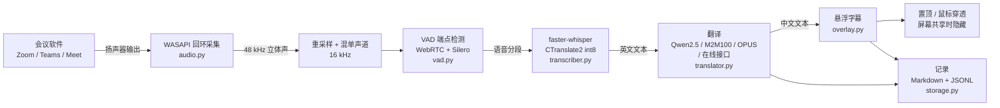

# 架构与设计取舍

这份文档解释 MeetSub 内部怎么跑，以及几个关键决定为什么这样做。功能说明见
[README](../README.md)，排错见 [TROUBLESHOOTING](TROUBLESHOOTING.md)。

## 数据流

采集、识别、翻译三条链路各在自己的工作线程里跑，Qt 主线程只负责界面刷新；任何一段
卡住都不会冻住另一段。模型在「开始字幕」时一次性加载并预热，之后常驻内存。

## 模块分工

| 文件 | 职责 |
| --- | --- |
| `meetsub/audio.py` | WASAPI 回环采集、设备解析、重采样、电平 |
| `meetsub/vad.py` | WebRTC VAD 切句、预卷、中间结果、Silero 二次校验 |
| `meetsub/transcriber.py` | faster-whisper 引擎、ASR 队列、文本清理 |
| `meetsub/translator.py` | Qwen LLM / M2M100 / OPUS / OpenAI 兼容 / Ollama、翻译队列 |
| `meetsub/pipeline.py` | 开始 / 暂停 / 结束、会话编排、状态机 |
| `meetsub/storage.py` | Markdown + JSONL 原子写入 |
| `meetsub/models.py` | 模型目录优先级、完整性校验、断点续传下载 |
| `meetsub/config.py` | 配置归一化、校验、DPAPI 加密的密钥保管 |
| `meetsub/dpapi.py` | Windows DPAPI 加解密封装 |
| `meetsub/app.py` | 主窗口、托盘、单实例唤醒、信号编排 |
| `meetsub/ui/` | 主窗口、悬浮字幕、设置面板、模型下载向导、主题 |

## 关键取舍

### 1. 抓系统输出，而不是麦克风

会议里说话的是远端的人，声音从扬声器/耳机出来。抓麦克风只会录到本机房间的环境音，
还会把本机说话人混进去。WASAPI loopback 直接拿到「电脑正在播放」的混合音频，与是否
戴耳机、是否静音麦克风无关。

代价：声音必须从**本机**输出设备播放；独占模式输出、DRM 音频、部分虚拟声卡无法捕获。
切换默认输出设备后需要暂停再继续，应用会在恢复时重新解析设备。

### 2. CPU int8 推理，不依赖显卡

会议场景下机器往往同时在跑 Zoom、共享屏幕、开一堆浏览器标签。把 Whisper 与翻译都放在
CPU 上用 int8 量化，能避免和会议软件抢 GPU、也避免要求用户有独显。默认 `small.en` +
Qwen2.5-1.5B 在近十年 x64 CPU 上可用，代价是模型常驻内存 2–2.8 GB。

### 3. 用本地 LLM 而不是传统 NMT

传统 NMT（M2M100 / OPUS-MT）逐句翻译，没有上下文，`launch`、`architecture`、`SLA`
这类词经常灾难性误译。Qwen2.5-1.5B 是纯 decoder 的指令模型，可以把「会议背景 + 术语表 +
最近两句上下文」塞进提示词：

| 英文原句 | M2M100-418M | Qwen2.5-1.5B |
| --- | --- | --- |
| We need to align on the launch date before Friday. | 我们需要在星期五之前调整发射日期。 | 我们需要在周五之前确定发布日期。 |
| Let me share my screen and walk you through the architecture. | 让我分享我的屏幕，让你走过建筑。 | 让我展示屏幕，并带您讲解架构。 |
| The SLA requires 99.9% uptime, so the rollback plan is critical. | — | SLA 要求 99.9% 的可用性，因此回滚计划至关重要。 |

代价是每句多 1–2 秒生成时间、多约 1.5 GB 模型。对延迟敏感的场合，应用允许一键切回
M2M100 / OPUS-MT，或改用在线接口。

### 4. 双层 VAD

WebRTC VAD 负责低延迟切句（30 ms 帧，静音 650 ms 定稿），Silero ONNX 在最终段上再做
一次判断，过滤纯噪声与误触发。这样既保住响应速度，又减少 Whisper 在无语音片段上的
幻觉（Whisper 遇到静音容易凭空输出「Thank you.」「字幕由...提供」之类）。

另外，除 WebRTC 判定外，持续低能量也会强制结束当前段——某些回环设备会把「数字静音」
误判成连续语音，导致一句话永远等不到停下。

### 5. 句级翻译 + 中间结果

Whisper 的输出不是真正的流式：每 200–300 ms 拿一次快照，先以灰色显示中间结果，停顿
定稿后再送去翻译。中文在停顿后才落定，因此默认有 1–2 秒句末延迟。这是「不改模型、
不接云端」前提下能做到的工程折中；若要做到逐词上屏，需要引入 LocalAgreement-2 之类的
提交策略，见「后续可做」。

### 6. 隐私默认值

- 默认翻译完全离线，音频与文字都不出本机；
- 在线翻译只发文字、只接受 HTTPS（本机 Ollama 除外）；
- API Key 用 Windows DPAPI 加密到 `%APPDATA%\MeetSub\secrets.bin`，配置文件里没有明文；
- 字幕窗口调用 `SetWindowDisplayAffinity(WDA_EXCLUDEFROMCAPTURE)`，常规屏幕共享/录屏
  中不可见；
- 日志只记录设备、耗时与错误，不记录会议文本。

## 参考与借鉴

1.0.0 交付后参考了以下开源实时转写项目的公开设计，并做了适合「系统音频 + 桌面悬浮字幕」
场景的实现：

- [WhisperLiveKit](https://github.com/rennf93/WhisperLiveKit)：本地流式 ASR、VAD、翻译
  与 OpenAI/Deepgram 兼容接口的整体思路。
- [WhisperLive](https://github.com/collabora/WhisperLive)：Whisper 后端、分段音频、实时
  服务端架构。
- [RealtimeSTT](https://github.com/KoljaB/RealtimeSTT)：低延迟 VAD、faster-whisper、即时
  转写。
- [ufal/whisper_streaming](https://github.com/ufal/whisper_streaming) 与论文
  [Turning Whisper into a Real-Time Transcription System](https://aclanthology.org/2023.ijcnlp-demo.3.pdf)：
  Whisper 流式化与 LocalAgreement 思路。

本项目**没有**直接复制上述项目的代码，也没有实现完整的 LocalAgreement 流式提交；当前方案是
「短分段 + 中间结果 + 句末定稿 + Silero 校验」。

## 后续可做

- LocalAgreement-2 提交策略，进一步压缩句末延迟；
- 术语表按会议类型预设（产品评审 / 架构评审 / 招聘面试）；
- 说话人分离（需要额外的声纹模型，会显著增加内存）；
- 记录文件自动脱敏与过期清理。

## 本地数据路径

| 内容 | 路径 |
| --- | --- |
| 配置 | `%APPDATA%\MeetSub\config.json` |
| 加密密钥 | `%APPDATA%\MeetSub\secrets.bin` |
| 日志 | `%LOCALAPPDATA%\MeetSub\logs\meetsub.log` |
| 字幕记录 | `%USERPROFILE%\Documents\MeetSub\transcripts` |
| 模型 | 便携版 `models\`；缺省下载到 `%LOCALAPPDATA%\MeetSub\models` |

模型目录查找优先级：`MEETSUB_MODEL_DIR` → 应用目录 `models\` → `%LOCALAPPDATA%\MeetSub\models`。
应用没有云端账户系统；删除程序目录不会自动清理以上数据。
